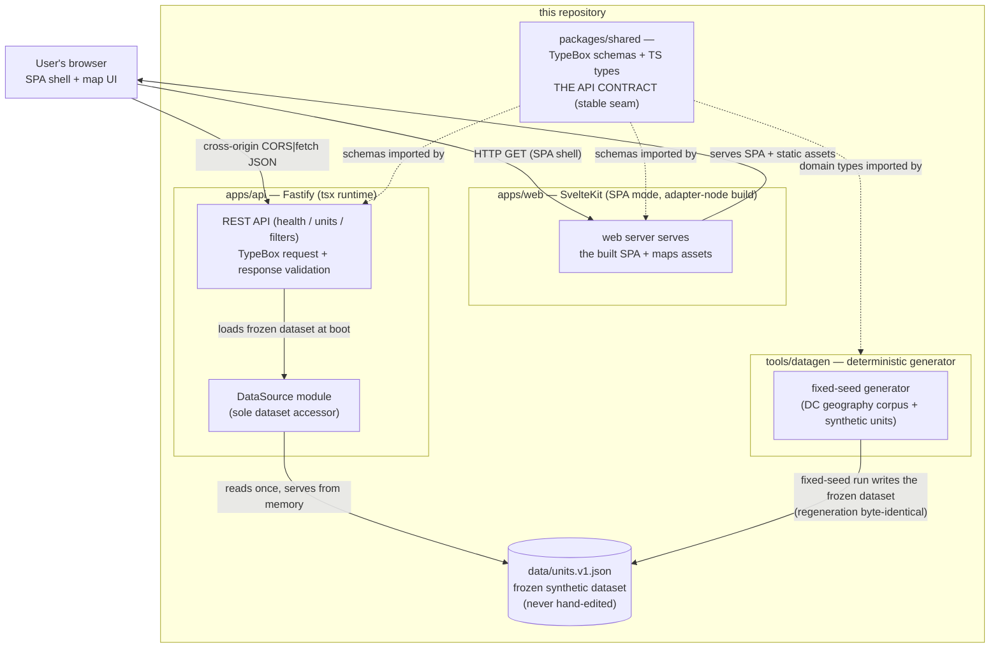

# Architecture — DC Reentry Housing Discovery

The system truth for the display prototype: what runs, how data flows, and
where the stable seams sit. Commands referenced here are verified in
[runbook.md](runbook.md); the enforced versions of the seams live in
`.dependency-cruiser.cjs` (`pnpm arch:check`) and the workspace layout in
`AGENTS.md`.

## System diagram

The diagram below is generated from the same diagram-as-code source this
document carries in its ```mermaid block — there is no separate source
file: the block is the truth, and `node scripts/check-diagrams.mjs`
validates renderability of exactly what is committed (see the script header
for the mechanism rationale).



## What runs

- **User browser** — the Svelte 5 (runes) single-page app: MapLibre map +
  card list of available units, schema-driven filter row, slide-over detail
  ending at provider contact info. The browser is the only place the map
  renders; the app degrades to unavailable-state messaging rather than
  inventing inventory.
- **`apps/web`** — the SvelteKit app served in production by its
  adapter-node output (port 5173 in parity setups). It holds no dataset:
  the SPA shell is static from the API's perspective, and unit data is
  fetched from the API at runtime. `VITE_API_URL` is baked at build time
  (see `apps/web/Dockerfile` + `docs/api.md` for the CORS contract this
  implies).
- **`apps/api`** — the Fastify server (TypeBox validation, runs on tsx —
  no separate build step for the API itself). `apps/api` mounts
  `/health`, `/units`, `/filters`; every response body is schema-validated
  against `packages/shared` before it leaves the process. The frozen
  dataset is loaded from disk once at boot and served from memory; inside
  the API, only the `DataSource` module touches it (seam; see below).
- **`tools/datagen`** — the deterministic synthetic-data generator: real DC
  geography corpus + invented unit/policy data, written with a fixed seed so
  regeneration is byte-identical (CI asserts this with a diff on `data/`).
- **`data/units.v1.json`** — the committed frozen dataset the API loads.
  Never hand-edit; regenerate instead (see `docs/data-synthetic.md`).

## The stable seams

- **`packages/shared` is THE API CONTRACT.** Both the API's request/response
  schemas and the web app's DTO expectations live there, so a contract
  change breaks typecheck on both sides in the same commit. Additive-first:
  breaking changes must be versioned (see `docs/shared-contracts.md`).
- **The `DataSource` seam inside `apps/api`**: routes reach the dataset
  only through the `DataSource` module — never the JSON file directly —
  so the ingestion pipeline (which today is a single frozen file) can later
  gain a real backend without touching route code.
- **No schema drift**: `pnpm arch:check` (dependency-cruiser) enforces that
  `packages/shared` imports nothing from the apps/tools, and that every
  app/tool imports only `packages/shared`.

## Known build/runtime boundaries

- Only `apps/web` (and the web Dockerfile) has a build step; `apps/api` and
  `packages/shared` are consumed as source from their respective servers
  and the datagen CLI, all running on tsx.
- The web Dockerfile bakes `VITE_API_URL` at build time; unsigned CORS
  allow list matching is done on the API side. See `docs/api.md` before
  drawing any change that alters the served origin.
