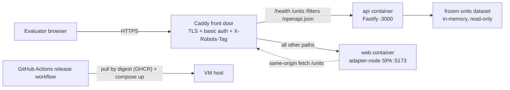

# Deployment plan

Status: planned, not yet implemented. This document is the committed
deployment design: environments, release lanes, pipeline, controls, and
verification. The implementation change that follows carries the workflows
and configuration. Decision provenance is recorded inline by date; the
evidence-backed research backing these choices (retrieved 2026-11-16, with
citations to provider and search-engine documentation) lives with the
planning workspace and is summarized here.

## Architecture overview

The deployed unit is the existing two-service stack behind one Caddy front
door on a single Linux VM (Amazon Lightsail to start; nothing in the design
is AWS-specific):

- **Single hostname, same-origin** (user decision 2026-11-16): the SPA is
  served at `https://<host>/` and the API answers at its **real root
  paths** — `/health`, `/units`, `/filters`, `/openapi.json` — on the same
  origin, routed by the proxy to the API upstream; every other path goes to
  the web upstream. One origin means one Basic-Auth realm and no CORS in
  the deployed environment. The API base URL is baked at image build time
  as `VITE_API_URL=https://<host>` — an **origin-style base with no path**,
  the same shape the client uses against `http://localhost:3000` today
  (the client resolves root-absolute request paths against the base
  origin, so a base carrying a path prefix could never work without an
  application change). The served CSP blesses that same origin for
  `connect-src`. No application changes.
- **Route-list sync**: the front door's API path list must cover the API's
  route set; a newly added API route routes to the web upstream until the
  proxy list is updated. The smoke gate exercises `/units`, so drift is
  caught at the next deploy.
- **Containers stay loopback-only**: web (:5173) and api (:3000) publish to
  `127.0.0.1` exactly as `compose.yaml` does today. Only the proxy listens
  on 0.0.0.0 (80/443). No origin bypass.
- **Provider-neutral by construction** (user decision 2026-11-16): images
  are published to GitHub Container Registry, the proxy config is portable,
  and deployment is `docker compose pull && docker compose up -d`. Moving to
  any other Linux VM provider is a DNS repoint plus re-run of the bootstrap;
  no AWS-specific coupling exists outside the instance itself.

## Environments

| Environment  | Purpose                                      | Hostname                                           | Status                                         |
| ------------ | -------------------------------------------- | -------------------------------------------------- | ---------------------------------------------- |
| `internal`   | Internal evaluation by a small trusted group | `internal.<domain>` (placeholder — see open items) | first to be provisioned                        |
| `production` | Public release                               | `<domain>` or `www.<domain>`                       | designed, provisioned later on the tagged lane |

Only the internal environment is provisioned initially; both lanes below
are designed now so the pipeline lands once. The synthetic-data disclosure
banner that the web app already renders stays visible in **every**
environment, production included — the dataset is synthetic everywhere, so
the disclosure is honest everywhere and no suppression path exists
(user decision 2026-11-16).

The environment hostname must be settled before the first web image build:
`VITE_API_URL` (and the CSP derived from it) is baked at build time, so the
hostname is a build input, not a runtime setting. A different hostname
means a different image, which is exactly how the pipeline treats it.

## Release lanes

### Weekly internal lane (now)

- **Trigger**: scheduled weekly, Monday ~15:17 UTC (chosen off the top of
  the hour; GitHub scheduled workflows are best-effort and can be delayed
  under load), plus manual `workflow_dispatch` for the first deploy,
  retries, and urgent fixes (user decision 2026-11-16).
- **Candidate revision**: the workflow snapshots `main` HEAD once, reruns
  the release checks on that exact SHA, and never silently falls back to an
  older commit. If `main` is broken, the release fails loudly and the
  environment keeps serving the last good deploy.
- **Skip-if-unchanged**: the candidate SHA is compared against the last
  _successfully deployed_ SHA (not the calendar); equal means skip unless an
  explicit redeploy input is set.
- **Artifacts**: builds the web image with the internal API base URL and
  the API image from the pinned SHA, pushes both to GHCR, and records a
  deployment manifest: source SHA, workflow run, environment, exact image
  digests, and the runtime configuration reference (no secrets).
- **Announcement**: on success, a short "what changed" note for evaluators
  covering previous-deployed-SHA → deployed-SHA. Internal notes stay out of
  GitHub Releases — a Release remains a shipped production artifact.

### Tagged production lane (later)

- **Trigger**: a human pushes a `vMAJOR.MINOR.PATCH` tag on an evaluated
  `main` commit. Tags created by automation using `GITHUB_TOKEN` do not
  trigger tag workflows, so the tag push is deliberately manual.
- The workflow validates the version syntax and `main` ancestry, reruns
  release checks on the exact tagged SHA, builds the _production_ web image
  (production API base URL — a separate build, never a promotion of the
  internal web image), publishes images, and prepares a **draft** GitHub
  Release with generated notes baselined against the previous _production_
  tag. The release is published only after deployment verifies green.
- **Versioning contract**: one application version for the coordinated
  web + API release. What "compatible" means (documented API behavior,
  supported URLs, externally consumed data formats) is declared before the
  first public `1.0.0`; until then versions stay in `0.y.z` initial
  development. A visual redesign is not automatically a major bump.

### Ad-hoc test-build lane (free, ephemeral)

For informal "share a link for the next hour" testing — alongside, never
instead of, the internal environment (user decision 2026-11-16):

- **Mechanism**: Cloudflare Quick Tunnel from the host running the stack —
  `cloudflared tunnel --url http://127.0.0.1:8080` — publishing a random
  `*.trycloudflare.com` HTTPS URL with no Cloudflare account or domain
  (documented limits: no uptime guarantee, 200 in-flight request cap, no
  SSE, hostname changes every run).
- **The tunnel always points at the Caddy front door**, never directly at a
  loopback upstream: the Basic-Auth wall, `X-Robots-Tag`, and disclosure
  banner apply unchanged to every tunnel URL.
- **Build order is fixed by the baked-URL constraint**: launch the tunnel
  first, then build the web image with
  `VITE_API_URL=https://<tunnel-host>` for that hostname, then bring
  the stack up behind it. A tunnel URL cannot serve a previously built
  image for a different hostname.
- Suitable for evaluator demos and per-branch test builds; not a stable
  surface (the weekly internal lane is).

### Recovery lane

A manual workflow (or documented runbook step) accepts an environment and a
retained manifest and redeploys the recorded web/API image **digests** with
their compatible runtime configuration — no source rebuild. Rollback
redeploys the known-good pair; it does not rebuild history.

## Pipeline design

All pipeline mechanics live in GitHub Actions (already the CI runner):

1. **Predeploy gate** (on the pinned SHA): the existing deterministic gates
   — lint, format, typecheck, arch, tests — plus the production-style
   container builds.
2. **Publish**: push to GHCR with `GITHUB_TOKEN` (`packages: write`).
   Image identity policy:
   - every build gets a unique immutable tag
     (`internal-sha-<fullsha>-run-<id>-attempt-<n>` / `prod-v<version>`) —
     the attempt suffix keeps re-run builds of one run distinct;
   - deploys and rollbacks reference `image@sha256:…` digests, never
     moving tags;
   - `latest`-style aliases, if kept at all, are convenience pointers
     updated only after a verified deploy.
   - Registry layout: one API package, plus separate internal and
     production web packages — environment mistakes then become visible as
     the wrong package rather than the wrong tag on the right package.
3. **Deploy**: the workflow SSHes to the VM (ephemeral runner, SSH key from
   an Actions secret), pulls the exact digests, and applies them via a
   compose override for the deployed topology (proxy + loopback-only
   services; whether the proxy runs as a host service or a containerized
   sidecar with host networking is an implementation decision — it must
   reach the loopback-published upstreams). Deployments to an environment
   are serialized.
4. **Readiness + smoke gate** (below) must pass before the manifest is
   recorded as the environment's last-good state.

GHCR image storage and bandwidth are free as of 2026-11; the VM pulls
private images with a read-only deploy credential configured once at
bootstrap.

## Crawler exclusion and access control

Layered, per current search-engine guidance (retrieved 2026-11-16):

1. **Authentication is the real boundary** — `X-Robots-Tag` is crawler
   advice, not access control. The Caddy front door requires Basic Auth
   over HTTPS for **every** path (SPA paths, the API's paths, static
   assets, health routes), with **individual evaluator accounts** — bcrypt
   hashes, one entry per person; provisioning or revoking access is a
   one-line change and a reload (user decision 2026-11-16). Credentials
   live only on the host, never in the repo.
2. **`X-Robots-Tag: noindex, nofollow` on every response** — HTML, static
   assets, API JSON, and the proxy's own 401/error responses. Applied at
   the proxy so both services and all status codes are covered.
3. **No blanket robots.txt disallow.** A `Disallow: /` would stop
   cooperating crawlers from fetching the pages at all — and a crawler that
   cannot fetch a page can never see its `noindex` signal; blocked URLs can
   still appear in indexes from external links. Authentication stays the
   enforcement; the header is defense in depth. (`noarchive` is omitted:
   Google documents that it now ignores the directive.)
4. **No origin bypass**: upstream ports are loopback-only; the VM firewall
   allows only 22/80/443 (SSH restricted to key auth).

Health probes stay private: the platform's readiness check targets the
loopback upstreams directly; the public smoke check authenticates.

## Secrets and configuration handling

- **Application runtime env** (API): `API_CORS_ORIGINS` stays locked to
  exact origins — in the deployed same-origin topology the API receives
  same-origin requests, so no deployed origin needs to be allowlisted;
  local dev parity (localhost:5173) is unchanged.
- **Evaluator credentials**: bcrypt hashes provisioned on the host at
  bootstrap; rotation is an on-host edit plus proxy reload. Never committed.
- **CI → VM**: one SSH deploy key (Actions secret). **VM → GHCR**: one
  read-only registry credential on the host. Scopes are separate: the
  build/publish job never holds deployment secrets, and the deploy job
  never holds publish credentials.
- **Manifests**: each deploy records source SHA + image digests +
  environment + configuration reference (no secrets) so any deployed state
  is reproducible.

## Rollback

- The last-good manifest (web digest, API digest, config reference) is
  retained per environment; rollback redeploys that pair by digest.
- Both referenced images must still exist in the registry — release images
  are retained, not garbage-collected on a schedule shorter than the
  rollback horizon.
- Rollback is a redeploy of recorded digests, compatible config, and a
  smoke check — never a rebuild of previous source.
- Expect brief interruption during rollback on this topology (compose
  recreate); it is a manual, deliberate action.

## Verification gates

Every deploy must pass, in order:

1. **Predeploy**: deterministic repo gates green on the exact SHA
   (lint, format, typecheck, arch, tests) + both container images build.
2. **Readiness**: deployed services report healthy (API `/health`, web
   shell 200), probed at their loopback upstreams — privately, not through
   the authenticated front door (an unauthenticated proxy probe would 401
   by design; the authenticated end-to-end check is gate 3).
3. **Authenticated browser smoke** (the gate that actually proves the
   environment): with evaluator credentials, a real browser —
   - loads the SPA and the **synthetic-data disclosure banner is visible**
     (rendered-browser check; served-HTML greps cannot prove SPA rendering);
   - completes a same-origin data roundtrip through the API's real paths
     (`/units`) — proving the baked API base URL, the front-door routing,
     and the data pipeline;
   - shows `X-Robots-Tag: noindex, nofollow` on both a web and an API
     response;
   - without credentials, requests to both services — SPA paths and API
     paths — answer 401 (no unauthenticated content, no origin bypass).
4. **Record**: on green, the manifest becomes the environment's last-good
   state and the "what changed" note ships to evaluators.

## Cost outline (as of 2026-11-16)

- Lightsail VM: $7/mo (1 GB) expected sufficient — the API holds ~1.2 MB of
  JSON in memory and both containers are modest; validate at bootstrap and
  size up to the 2 GB / $12 tier if measured headroom is thin.
- Snapshots: ~$0.05/GB/mo. GHCR storage/bandwidth: free as of 2026-11.
- GitHub Actions: free tier for this repo's profile.

## Open items

- **Internal hostname**: subdomain of an owned domain vs a newly registered
  domain — undecided (user, 2026-11-16). Must settle before the first web
  image build; the plan carries `internal.<domain>` until then.
- **Memory sizing**: confirm 1 GB is comfortable under real container load
  at bootstrap; escalate to the 2 GB tier if not.
- **Serving-posture baselines**: the open API serving-restart resilience
  investigation and the planned static-asset response-headers baseline
  precede the pipeline inheriting the same images; land them before or
  alongside the implementation.
- **Production provisioning**: deferred until the tagged lane is first
  used; the design above is complete but nothing production-facing is
  provisioned now.
